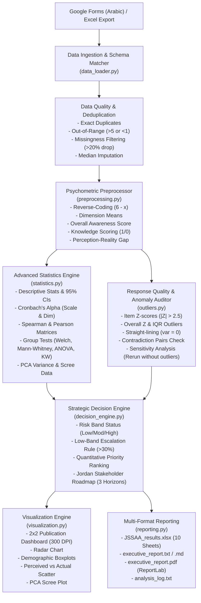

# JSSAA: Jordan Social & Security Awareness Analysis
### نظام تحليل وقياس الوعي الأمني والمجتمعي في المملكة الأردنية الهاشمية

[](https://www.python.org/)
[](LICENSE)
[]()
[]()

---

## 1. Executive Summary & Overview (الملخص التنفيذي بالعربية)

**مشروع JSSAA** هو منصة تحليلية إحصائية وأكاديمية متكاملة ومصممة خصيصاً للمجتمع الأردني. يهدف المشروع إلى قياس وتقييم مستويات الوعي حيال الشائعات، والمعلومات المضللة، والتهديدات الرقمية الحديثة (كالتصيد الإلكتروني، وعمليات الاحتيال المرتبطة بالمحافظ الإلكترونية ونظام كليك CliQ، وسرقة الحسابات).

يقوم النظام باستقبال ردود الاستبانات المجهولة (عبر Google Forms باللغة العربية)، وإجراء الفحص الآلي لجودة البيانات، وتطبيق القياس السيكومتري (معامل ألفا كرونباخ، والتحليل العاملي للمركبات الرئيسية PCA)، واختبار الفروق الإحصائية بين الفئات الديموغرافية (النوع الاجتماعي، الفئات العمرية، المحافظات، المستويات التعليمية)، وكشف الأنماط الشاذة والمريبة، ثم توليد لوحة مؤشرات رسومية عالية الدقة (300 DPI) وتقرير قرار تنفيذي يحدد الأولويات الوطنية والتوصيات العملية الموجهة للجهات الأردنية ذات العلاقة (مثل المركز الوطني للأمن السيبراني، ووحدة مكافحة الجرائم الإلكترونية، وهيئة الإعلام).

---

## 2. System Architecture & Analytic Pipeline



---

## 3. Directory Structure

```text
JSSAA/
├── main.py                     # CLI entry point orchestrating the end-to-end pipeline
├── config.py                   # Central settings, survey mapping, thresholds, questions
├── requirements.txt            # Python dependencies
├── README.md                   # Full academic and deployment documentation
├── SURVEY_TEMPLATE.md          # Ready-to-paste Google Forms questionnaire (AR + EN)
├── data/
│   ├── sample_generator.py     # Synthetic data generator modeling Jordanian demographics
│   ├── sample_survey_responses.xlsx  # SYNTHETIC validation dataset (clearly marked)
│   └── survey_responses.xlsx   # Destination for actual field data
├── src/
│   ├── __init__.py
│   ├── data_loader.py          # Data ingestion, schema validation, cleaning, imputation
│   ├── preprocessing.py        # Reverse-coding, dimensional scoring, perception gap
│   ├── statistics.py           # Descriptive stats, Cronbach's alpha, tests, PCA
│   ├── outliers.py             # Z-score, IQR, straight-lining, consistency, sensitivity
│   ├── decision_engine.py      # Severity bands, priority formula, Jordan recommendations
│   ├── visualization.py        # 300 DPI 2x2 dashboard, radar, boxplots, scatter, scree
│   └── reporting.py            # Multi-tab Excel, TXT, Markdown, and PDF generators
├── outputs/                    # Auto-generated analytical artifacts
└── tests/
    ├── __init__.py
    └── test_pipeline.py        # 9 unit & integration tests (100% pass)
```

---

## 4. Installation & Environment Setup

### Prerequisites
- Python 3.9, 3.10, 3.11, 3.12, 3.13, or 3.14.
- Windows, macOS, or Linux.

### Setup Instructions
```bash
# 1. Clone or navigate to the repository directory
cd "Jordan Social & Security Awareness Analysis"

# 2. (Optional but recommended) Create and activate a virtual environment
python -m venv venv

# On Windows (PowerShell):
.\venv\Scripts\Activate.ps1
# On macOS / Linux:
source venv/bin/activate

# 3. Install required dependencies
pip install -r requirements.txt
```

---

## 5. Deployment with Google Forms (Step-by-Step Guide)

To collect real data and execute the JSSAA pipeline:

1. **Deploy Questionnaire:**
   - Open [SURVEY_TEMPLATE.md](file:///d:/Jordan%20Social%20&%20Security%20Awareness%20Analysis/SURVEY_TEMPLATE.md).
   - Create a new Google Form in Arabic.
   - Copy the exact question strings from `SURVEY_TEMPLATE.md`.
   - **Crucial Setting:** In Google Forms **Settings -> Responses**, ensure **"Collect email addresses"** is set to **"Do not collect"**, and ensure **"Requires sign-in"** is unchecked.

2. **Link to Google Sheets:**
   - In Google Forms, click on the **Responses (الردود)** tab.
   - Click the green **Link to Sheets (الربط بجداول البيانات)** icon.

3. **Export Response Spreadsheet:**
   - In the linked Google Sheet, navigate to:  
     `File` -> `Download` -> `Microsoft Excel (.xlsx)`
   - Rename the downloaded file to `survey_responses.xlsx`.
   - Move `survey_responses.xlsx` into the `data/` folder:
     ```text
     data/survey_responses.xlsx
     ```

4. **Run Analytics Pipeline:**
   ```bash
   python main.py --input data/survey_responses.xlsx --output outputs
   ```
   *Note: If `data/survey_responses.xlsx` is not found, `main.py` automatically falls back to `data/sample_survey_responses.xlsx` with an informative warning.*

---

## 6. Synthetic Data Notice (بيان البيانات التجريبية)

The file `data/sample_survey_responses.xlsx` is **SYNTHETICALLY GENERATED** for demonstration, validation, and automated unit testing. It models:
- Realistic Jordanian demographic distributions (Amman ~42%, Irbid ~19%, Zarqa ~14%, young age skew).
- Known correlation structures (e.g. latent trust associated with awareness).
- Injected quality defects to test data audits: 5 exact duplicates, 3 out-of-range values, 1 respondent with >20% missingness (dropped), 15 missing cells (median imputed), 8 straight-liners, and 5 logical contradictions.

To regenerate fresh synthetic data at any time:
```bash
python data/sample_generator.py
```

---

## 7. Command-Line Interface (CLI) Arguments

```bash
python main.py [OPTIONS]
```

| Flag | Type | Default | Description |
|---|---|---|---|
| `--input` | String | `data/survey_responses.xlsx` | Path to response file (`.xlsx` or `.csv`). Falls back to synthetic sample if absent. |
| `--output` | String | `outputs` | Target directory for generated charts, spreadsheets, and reports. |
| `--sheet` | Int / String | `0` | Sheet index or name for Excel workbooks. |
| `--no-pdf` | Flag | `False` | Disables ReportLab PDF compilation (generates TXT, MD, XLSX, and PNGs). |
| `--sensitivity` | Flag | `True` | Forces sensitivity analysis re-estimating models without flagged suspicious records. |

---

## 8. Academic & Statistical Methodology Guide

### A. Reliability (Cronbach's Alpha)
Internal consistency is modeled using vectorized sample variance ($ddof=1$):
$$\alpha = \frac{k}{k - 1} \left( 1 - \frac{\sum_{i=1}^k \sigma_i^2}{\sigma_X^2} \right)$$
Evaluated across:
- Full survey instrument (23 Likert items).
- Awareness scale (19 items excluding media exposure context items).
- Each individual dimension: `media_exposure`, `rumor_detection`, `digital_threat_awareness`, `official_source_trust`, `verification_behavior`.
- Includes **alpha-if-item-deleted** and **corrected item-total correlations** to identify ill-fitting items.

### B. Correlation Analysis
- **Spearman Rank Correlation ($\rho$):** Primary metric due to ordinal Likert scale properties.
- **Pearson Linear Correlation ($r$):** Provided concurrently for dimensional score vectors.
- Exact two-tailed $p$-values and significance flags ($*p < 0.05, **p < 0.01, ***p < 0.001$).
- Specific focus on the relationship between `media_exposure` and verification habits.

### C. Inferential Demographic Group Testing
- **Normality Check:** Shapiro-Wilk test on dependent variable distributions per subgroup.
- **Variance Homogeneity:** Levene's test across comparison groups.
- **2 Groups (e.g. Gender):**
  - Parametric: Welch's $t$-test (robust against unequal variances) with Cohen's $d$.
  - Non-parametric: Mann-Whitney $U$ test with rank-biserial correlation $r_{\text{rb}}$.
- **3+ Groups (e.g. Age Group, Governorate, Education):**
  - Parametric: One-Way ANOVA with Eta-squared ($\eta^2$).
  - Non-parametric: Kruskal-Wallis $H$ test with Epsilon-squared ($\epsilon^2$).
  - Post-Hoc: Pairwise comparisons with **Bonferroni multiplicity correction**.

### D. Dimensionality (Principal Component Analysis - PCA)
Standardized PCA on reverse-coded items evaluates construct validity, eigenvalues (Kaiser criterion $\lambda > 1.0$), scree variance distribution, and primary component factor loadings.

### E. Anomaly Auditing & Sensitivity Analysis
- **Item Z-scores:** $|Z| > 2.5$ flags extreme outliers.
- **Overall Score Z & IQR:** Identifies distributional tails.
- **Straight-lining:** Identifies zero-variance response strings on raw Likert answers before reversing.
- **Logical Inconsistency:** Audits pairs (e.g. $RD1$ vs $RD5$, $OT1$ vs $OT4$) where $|x_{\text{normal}} - x_{\text{reversed}}| \ge 3$.
- **Sensitivity Re-estimation:** Core indicators (mean, alpha, status, rankings) are re-estimated without flagged respondents to guarantee policy recommendations are not driven by noisy or fraudulent responses.

---

## 9. Comprehensive Output Artifacts Catalog

All artifacts are saved to `outputs/`:

| Artifact | Format | Description |
|---|---|---|
| `jordan_awareness_dashboard.png` | PNG (300 DPI) | **Executive 2x2 Dashboard:** (1) Item means with 95% CIs and threshold lines; (2) Masked Spearman correlation heatmap; (3) Overall score histogram and KDE; (4) Donut chart of awareness risk bands. |
| `dimension_radar_chart.png` | PNG (300 DPI) | Polar 5-axis profile comparing sample means against target benchmark (4.0) and critical threshold (2.33). |
| `demographic_boxplots.png` | PNG (300 DPI) | Distribution boxplots with jittered strip overlay across Gender and Age cohorts. |
| `perceived_vs_actual_scatter.png` | PNG (300 DPI) | Scatter plot modeling Perceived Awareness vs Objective Knowledge with linear fit and risk quadrants. |
| `pca_scree_plot.png` | PNG (300 DPI) | Scree bar chart of explained variance and cumulative line with 70% threshold. |
| `JSSAA_results.xlsx` | Excel (.xlsx) | **10-Tab Master Workbook:** `Cleaned_Data`, `Descriptive_Stats`, `Dimension_Scores`, `Reliability`, `Correlation_Spearman`, `Correlation_Pearson`, `Group_Tests`, `Outliers_Flags`, `Recommendations`, `Action_Plan`. |
| `executive_report.md` | Markdown | Exhaustive strategic report with executive summary, psychometrics, group disparities, prioritized actions, and limitations. |
| `executive_report.txt` | Plain Text | Formatted text version of the executive decision report. |
| `executive_report.pdf` | PDF | Formatted executive decision report generated via ReportLab. |
| `analysis_log.txt` | Plain Text | Complete runtime console log capturing all ingestion statistics, warnings, and model runs. |

---

## 10. Research Ethics & Governance

1. **Complete Anonymity:**  
   No names, phone numbers, national IDs, email addresses, or IP addresses are gathered or stored.
2. **Voluntary Informed Consent:**  
   Participation is voluntary; respondents must be aged 18+ and can exit at any stage without prejudice.
3. **No Sensitive Political Inquiries:**  
   The instrument measures digital awareness, media consumption, and cyber threat hygiene. It does not probe partisan political affiliations.
4. **Aggregate Policy Reporting:**  
   All outputs report aggregated cohort metrics. Individual responses are confidential.

---

## 11. Running the Automated Test Suite

The test suite validates data ingestion, psychometrics, reverse-coding, anomaly auditing, threshold escalations, and end-to-end integration:

```bash
python -m pytest -v
```

Expected output:
```text
tests/test_pipeline.py::TestPsychometricsAndScoring::test_reverse_coding_exactness PASSED
tests/test_pipeline.py::TestPsychometricsAndScoring::test_awareness_band_categorization PASSED
tests/test_pipeline.py::TestPsychometricsAndScoring::test_cronbach_alpha_known_values PASSED
tests/test_pipeline.py::TestDataQualityAndAuditing::test_arabic_header_normalization PASSED
tests/test_pipeline.py::TestDataQualityAndAuditing::test_straightlining_detection PASSED
tests/test_pipeline.py::TestDataQualityAndAuditing::test_consistency_pairs_detection PASSED
tests/test_pipeline.py::TestDecisionAndPolicyEngine::test_escalation_rule PASSED
tests/test_pipeline.py::TestDecisionAndPolicyEngine::test_priority_score_formula PASSED
tests/test_pipeline.py::TestPipelineIntegrationSmoke::test_full_pipeline_run PASSED
======================== 9 passed in 7.8s ========================
```

